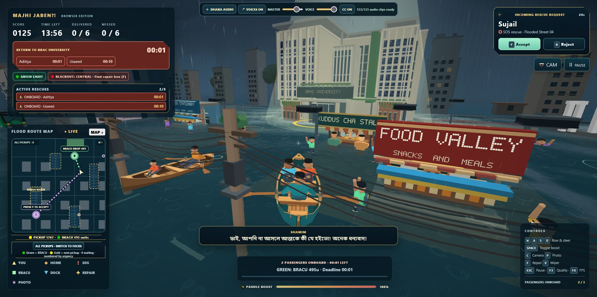
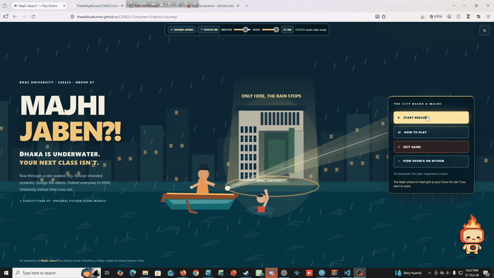
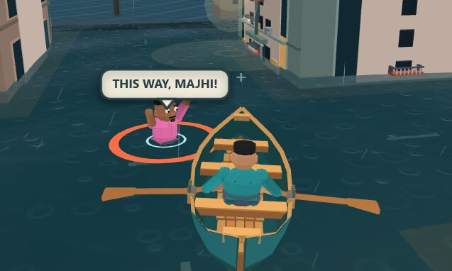
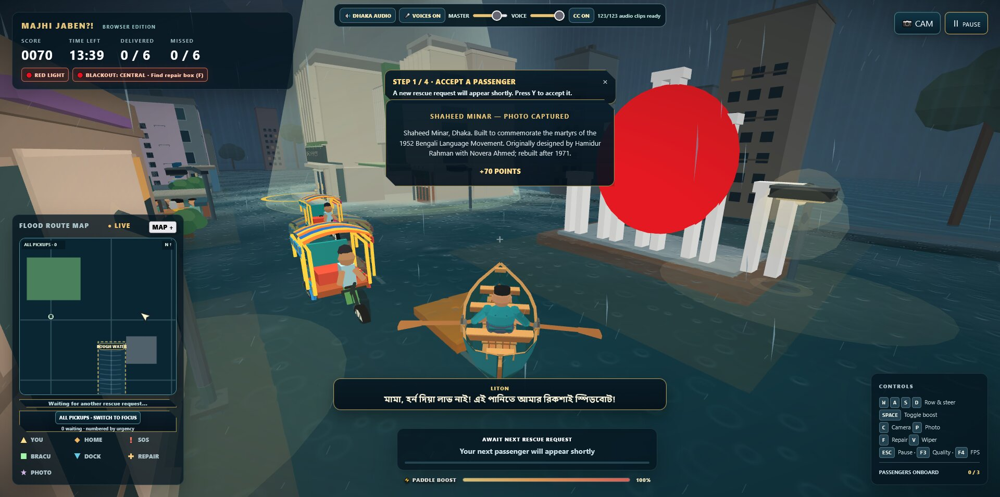
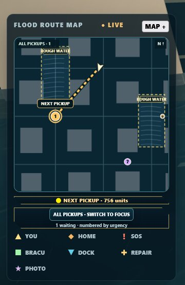

# CSE423 Computer Graphics: From Pixels to Paddles 🛶

**Dhaka is underwater. Your next class isn't.**

**_Majhi Jaben?!_** began as our CSE423 Computer Graphics team project at BRAC University: a 3D rescue game about getting stranded students to campus through a flooded Dhaka. We submitted the original Python/PyOpenGL game for the course—and kept exploring the idea even after our grades were out.

### 🎮 [Play Majhi Jaben?! Online](https://theadittyakumar.github.io/CSE423-Computer-Graphics-Journey/)

**Play on a desktop or laptop browser with WebGL support.** No installation needed. The mobile UI is **not yet ready**, so the desktop experience is recommended.

**Course:** CSE423 · Computer Graphics · BRAC University  
**Section:** 16 · **Project Group:** 07  
**Original team:** Adittya Kumar Chowdhury · Nafisa Lubaba · Usaeed Rahman Tibro  
**Independent WebGL expansion:** Adittya Kumar Chowdhury  
**Technology:** Python · PyOpenGL · OpenGL/GLU/GLUT · JavaScript · WebGL · GLSL

> From points, lines, and transformations in the lab to rescue missions, water simulations, Bangla-speaking characters, and one unusually sunny university.



<p align="center"><em>Majhi Jaben?! — post-course Python Cinematic Edition. The original screenshots and GIFs in this README have been preserved.</em></p>

---

## 🛶 About the project

The idea came from our own experience of Dhaka's monsoon flooding. We imagined a city where the roads are underwater, students are stranded, and you become a **majhi** (boatman) trying to get them to **BRAC University** before their deadlines expire.

The joke? **BRACU is somehow the only dry, sunny place in the city**—an idea partly inspired by an *Oggy and the Cockroaches* rain gag. We kept that playful spirit throughout the game, right down to the menu: try hovering over **Exit Game** and see what the majhi does with his flashlight.

The project grew in three stages:

1. **Original CSE423 submission:** our team-built Python/PyOpenGL game, developed within the course's OpenGL-function constraints.
2. **Post-course Python Cinematic Edition:** improvements to the original desktop game's presentation and interactions.
3. **Expanded Browser Edition:** an independently led JavaScript/WebGL adaptation with substantially more graphics, water simulation, sound, animation, and gameplay details.

The browser version retains the original game's concept and core systems, but it is **more than a direct port**. The graded submission, improved Python edition, and WebGL expansion are kept separate in this repository.

## ✨ Gameplay highlights

### 1) The menu has a sense of humor

The majhi's flashlight follows the menu options. Hovering over **Exit Game** triggers a rather bright response.



### 2) Rescue students—and get them to class

| Passenger pickup / rescue | Landmark photo challenge |
| :---: | :---: |
|  |  |
| Pick up stranded students from flooded streets and bring them to safety before their deadlines. | Photograph Dhaka landmarks such as **Shaheed Minar** to earn bonus points and learn their history. |

Other things you can do or encounter:

- **Time-sensitive rescues:** accept requests, track individual deadlines, and take up to three passengers at a time.
- **Flooded-city navigation:** avoid submerged vehicles and debris, steer through stronger currents, and use paddle boost when you need it.
- **A familiar Dhaka atmosphere:** rickshaws, CNGs, shops, buildings, electrical wires, stranded civilians, and other boats.
- **Power and traffic:** follow traffic signals and restore electricity to affected areas.
- **Weather and water:** rainfall, lightning, boat wakes, paddle ripples, and a mysteriously sunny BRAC University.
- **Character interactions:** Bangla voices, conversations, boarding animations, and BRACU gate checks where a missing student ID can become its own problem.
- **Different perspectives:** switch between first-person and third-person camera views, including a windshield-wiper effect.
- **A finale:** reach the rescue goal to see the ending sequence.

### 3) Real-time minimap

<p align="center">
  
</p>

<p align="center"><em>The minimap helps track the player's position, rescue pickups, and important destinations.</em></p>

**About the pictures:** The five images/GIFs above are preserved from the previous README and show the **Python Cinematic Edition**. For the newest WebGL graphics and interactions, [launch the browser game](https://theadittyakumar.github.io/CSE423-Computer-Graphics-Journey/).

---

## 🌐 Play the Browser Edition

**▶ [Launch Majhi Jaben?! — Play Online](https://theadittyakumar.github.io/CSE423-Computer-Graphics-Journey/)**

It runs on GitHub Pages using JavaScript and WebGL. You don't need Python, PyOpenGL, or a local build step to play it.

**Recommended:** A desktop/laptop browser with WebGL support and hardware acceleration. **Mobile UI is still unfinished.** The more advanced GPU water effects require WebGL 2; the game also includes a simpler WebGL 1 fallback.

**Main controls:**

| Key | Action |
| --- | --- |
| **W / S** | Row forward / backward |
| **A / D** | Steer left / right |
| **Space** | Toggle paddle boost |
| **C** | Change camera |
| **V** | Activate windshield wiper |
| **Y / N** | Accept / reject rescue request |
| **F** | Repair power when near an affected repair box |
| **P** | Take a landmark photo when in range |
| **Esc** | Pause / help |
| **F3 / F4** | Graphics quality / performance information |

> The Browser Edition expands on the earlier Python game; it is **not** the Python file submitted for grading. The original submitted source is preserved below.

---

## 🌊 Water Lab 02.1 — getting the floodwater to respond

One part I kept coming back to was the water. Our original Python game used **sine and cosine waves** for animated movement. I wanted the floodwater to react more convincingly when the boat moved, paddles entered the surface, or rain fell.

After studying [Evan Wallace's WebGL Water](https://madebyevan.com/webgl-water/) and other graphics resources, I built **Water Lab 02.1** as a separate WebGL 2 experiment before integrating its techniques into the main game.

**🔬 [Explore the standalone Water Lab 02.1](https://theadittyakumar.github.io/CSE423-Computer-Graphics-Journey/water-lab-01/)**

The experiment explores:

- A **GPU-based heightfield** that updates surface height and velocity to propagate waves.
- Localized **boat wakes, paddle disturbances, and rainfall ripples**.
- **Surface normals, lighting, view-dependent reflections, and refraction approximations**.
- **Caustic-style lighting** and simplified buoyancy-inspired responses.
- An intentionally readable view of roads beneath approximately **three metres of water** in the main game.

The result uses **physically inspired simulation plus artist-directed rendering**, not a full fluid-dynamics or Navier–Stokes solver. The WebGL game also includes a WebGL 1 fallback with simpler water effects.

### Other things I explored after CSE423

The browser expansion also became an opportunity to experiment with procedural 3D character and vehicle models, more detailed Dhaka-inspired scenery, animated rowing, weather effects, a clearer HUD, character-specific Bangla dialogue, randomized ID-card checks at the BRACU gate, and a cinematic ending.

I used **Google AI Studio** to generate distinct character voices and **ChatGPT** to assist with coding, debugging, and iterative revisions. Much of the process involved researching graphics demonstrations, trying an approach, checking what looked or behaved incorrectly, and improving it again. The research and independent expansion were led by Adittya after the original team project was submitted.

---

## 📁 Repository structure

```text
CSE423-Computer-Graphics-Journey/
│
├── Lab 1/                                # Early OpenGL exercises
├── Lab 2/                                # Graphics assignments
├── Lab 3/                                # 3D graphics assignments
│
├── Project proposal document/            # Original and updated proposals
├── Project submitted/                    # Faculty-graded Python project
│   └── MajhiJaben_FinalVersion.py
│
├── Updated project after CSE423 ended/   # Post-course Python Cinematic Edition
│   └── MajhiJaben_CinematicEdition_NoComments.py
│
├── docs/                                 # WebGL Browser Edition / GitHub Pages
│   ├── index.html
│   ├── styles.css
│   ├── game.js
│   ├── menu-scene.js
│   ├── audio/                            # Voices, ambience, and sound effects
│   └── water-lab-01/                     # Standalone WebGL water experiment
│
├── media/                                # Original README screenshots and GIFs
│   ├── bracu-campus.jpg
│   ├── exit-searchlight.gif
│   ├── landmark-challenge.jpg
│   ├── passenger-pickup.jpg
│   └── minimap-view.jpg
│
├── tools/                                # Supporting development tools
└── README.md
```

The repository separates the submitted coursework, subsequent Python work, and independent WebGL expansion so each stage can be explored on its own.

## 🎓 What we learned in CSE423 and how we applied it

| Course component | What we learned | How it contributed to *Majhi Jaben?!* |
| --- | --- | --- |
| Intro OpenGL templates | Drawing primitives, coordinate systems, colors, and transformations | Constructing roads, buildings, objects, and basic on-screen graphics |
| Lab 1 / Assignment 1 | Interactive drawing, animation, and color changes | Foundations for weather animation and interactive visual effects |
| Lab 2 / Assignment 2 | Midpoint line drawing, zone conversions, and graphics algorithm reasoning | Practice with coordinate-based algorithms and stepwise graphical logic; game-specific collision code was developed separately |
| Lab 3 / Assignment 3 | 3D transformations, perspective projection, camera control, and event handling | Boat and city geometry, camera views, object movement, and keyboard interaction |
| Final project | Combining graphics, animation, input, mathematics, and state management | Rescue requests, passenger deadlines, obstacles, repairs, landmarks, and the minimap |

Our coursework also covered color models, projection mathematics, curves, lighting, and shading theory. Not every technique studied was implemented in the submitted project; these topics provided a foundation for later experiments.

After CSE423, the independent WebGL expansion became a way to explore custom shaders, GPU simulation, additional graphics techniques, browser deployment, and more elaborate interaction systems.

---

## 📂 Project versions

### 1. Original faculty proposal

Located in [`Project proposal document/`](Project%20proposal%20document/). The original concept and its updated proposal.

### 2. Actual graded submission

Located at [`Project submitted/MajhiJaben_FinalVersion.py`](Project%20submitted/MajhiJaben_FinalVersion.py). The Python/PyOpenGL game developed by the three-person CSE423 team and submitted for course evaluation.

### 3. Post-course improved Python version

Located at [`Updated project after CSE423 ended/MajhiJaben_CinematicEdition_NoComments.py`](Updated%20project%20after%20CSE423%20ended/MajhiJaben_CinematicEdition_NoComments.py). A later enhanced Python Cinematic Edition.

> The original screenshots and GIFs in this README showcase this **post-course Python Cinematic Edition**, not the graded submission or the latest WebGL rendering.

### 4. Independently expanded WebGL Browser Edition

Located in [`docs/`](docs/) and published through GitHub Pages:

**🎮 [Play the latest Browser Edition](https://theadittyakumar.github.io/CSE423-Computer-Graphics-Journey/)**

### 5. Standalone Water Lab 02.1

Located in [`docs/water-lab-01/`](docs/water-lab-01/) as a separate rendering and simulation experiment:

**🌊 [Open Water Lab 02.1](https://theadittyakumar.github.io/CSE423-Computer-Graphics-Journey/water-lab-01/)**

---

## 🛠️ How to run

### Option A: Play online (recommended)

Open **[Majhi Jaben?! — Play Online](https://theadittyakumar.github.io/CSE423-Computer-Graphics-Journey/)** on a desktop or laptop with a WebGL-capable browser. No Python installation needed.

### Option B: Run the Python versions

Install Python 3 and the PyOpenGL dependencies:

```bash
python -m pip install PyOpenGL PyOpenGL_accelerate
```

A working **GLUT/FreeGLUT** runtime is also required for your operating system.

Run the graded course submission:

```bash
python "Project submitted/MajhiJaben_FinalVersion.py"
```

Run the later Python Cinematic Edition:

```bash
python "Updated project after CSE423 ended/MajhiJaben_CinematicEdition_NoComments.py"
```

*On Windows, `py` may be used instead of `python`, depending on your installation.*

---

## 🙌 Credits and references

**Original CSE423 team — Group 07, Section 16**  
Adittya Kumar Chowdhury · Nafisa Lubaba · Usaeed Rahman Tibro  
*BRAC University · CSE423 Computer Graphics*

**Independent post-course WebGL expansion**  
Adittya Kumar Chowdhury — research, design direction, prototyping, testing, integration, and AI-assisted development.

**Learning and technical references**

- [Evan Wallace — WebGL Water](https://madebyevan.com/webgl-water/) — inspiration for interactive water, heightfields, and water optics.
- [LearnOpenGL — Advanced Lighting](https://learnopengl.com/Advanced-Lighting/Advanced-Lighting) — lighting and specular-shading reference.
- [Kyle Robinson — OpenGL Lighting](https://github.com/kyle-robinson/opengl-lighting) — graphics and lighting examples.
- **Google AI Studio** — AI-generated Bangla character voice recordings.
- **ChatGPT** — AI-assisted implementation, debugging, and iteration.

Thanks to our CSE423 faculty for the course foundation, and to the developers who make their graphics demonstrations and resources available for others to learn from.

This is a fictional, humorous student project inspired by real monsoon experiences in Dhaka—not a realistic flood-rescue training simulation.

*From pixels to paddles—and a few experiments beyond the final grade.*
