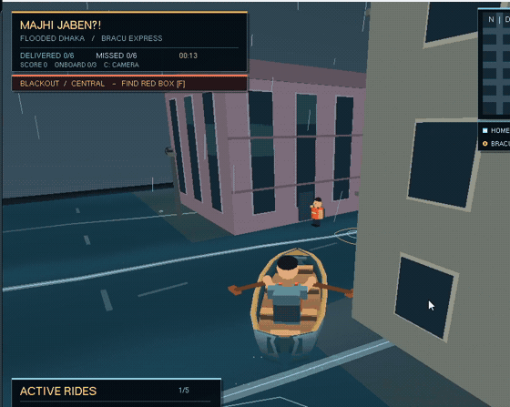
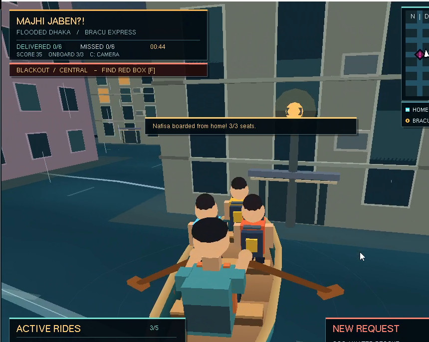

# CSE423 Computer Graphics — From Pixels to Paddles 🚣

**Our computer graphics coursework, three assignments, and _Majhi Jaben?!_ — a 3D boat-rescue game set in a fictional, flooded Dhaka.**

**Course:** CSE423 · Computer Graphics · BRAC University  
**Section:** 16 · **Project Group:** 07  
**Team:** Adittya Kumar Chowdhury · Nafisa Lubaba · Usaeed Rahman Tibro  
**Technology:** Python · PyOpenGL · OpenGL / GLU / GLUT

> We began by drawing points and lines. We ended up building a boat, a flooded city, and a way to get students to university on time.

<p align="center">
  
  <br />
  <sub>Actual gameplay from our <strong>post-course Cinematic Edition</strong> (not the version originally graded).</sub>
</p>

## 🚣 Meet *Majhi Jaben?!*

Inspired by our experience of heavy rain and flooded roads in Dhaka during the semester, including **12 July 2026**, we created a lighthearted rescue-and-transport game. Players row through a flooded neighborhood, accept student requests, pick up passengers, avoid obstacles and get everyone to **BRAC University** before their deadlines expire.

The humor is intentional: BRACU is the one place where the skies clear up, and the main menu has a theatrical response when you try to leave. This is an **arcade game**, not a realistic flood simulation.

### Actual gameplay GIFs

**1. Rescue a student:** accept a request, maneuver the boat, and pick up a waiting passenger.

<p align="center"></p>

**2. Try to quit:** hover over **Exit** on the title menu and watch the majhi's spotlight turn toward the player. 🔦

<p align="center"></p>

### More from the game

| Passengers onboard | Landmark photo challenge |
| :---: | :---: |
|  |  |

*All five images above were extracted from recorded gameplay of the later Cinematic Edition. They are not AI-generated gameplay.*

## 📁 Repository layout

This repository keeps the **graded course submission separate from improvements made after CSE423 ended**.

```text
CSE423 Repository/
├── Lab 1/
│   ├── Assignment 1/
│   ├── Hello_openGL.py
│   └── Lets_draw_sth.py
├── Lab 2/
│   └── Lab2Assignment22301518.py
├── Lab 3/
├── Project proposal document/
│   ├── Actual submitted report.docx
│   └── Updated report after CSE423 course ended ....docx
├── Project submitted/
│   └── MajhiJaben_FinalVersion.py
├── Updated project after CSE423 ended/
│   └── MajhiJaben_CinematicEdition_NoComments.py
├── media/
│   ├── bracu-campus.jpg
│   ├── student-pickup.gif
│   ├── exit-searchlight.gif
│   ├── student-rescue.jpg
│   └── landmark-challenge.jpg
└── README.md
```

*The long updated-report filename is abbreviated above; keep your actual filename. The Python filenames reflect the current Windows folder screenshots.*

## 🎓 From the labs to the project

| Stage | What we built / practiced | What we learned and reused |
| --- | --- | --- |
| **Lab 1 & Assignment 1** | OpenGL points, lines and polygons; a rainy house with day/night changes; moving, bouncing colored points | `glBegin`, `glVertex`, RGB colors, `glOrtho`, input callbacks and animation loops — later reused for the storm, city objects and HUD |
| **Lab 2 & Assignment 2** | **Catch the Diamonds** | Midpoint Line Algorithm, eight-way zone transformations, motion, collision checks and game state — useful foundations for interactive movement and pickups |
| **Lab 3 & Assignment 3** | **3D shooting game** | `glTranslatef`, `glRotatef`, `glScalef`, `gluPerspective`, `gluLookAt`, camera views and projectile/enemy collision — foundations for the boat, cameras and 3D city |
| **Final course project** | **Majhi Jaben?!** | Combining geometry, transforms, animation, cameras, input, timers and collision logic into a complete interactive project |

## 🗂️ Three milestones, clearly separated

### 1. The original faculty proposal

The proposal defined **15 core features**, allocated across three team members. It proposed ride requests, student deadlines, three-seat transportation, flood hazards, and interactive city systems. The original proposal and the later revised report are in **`Project proposal document/`**.

### 2. The actual CSE423 submission

**Source:** [`Project submitted/MajhiJaben_FinalVersion.py`](Project%20submitted/MajhiJaben_FinalVersion.py)

This is the version submitted for course evaluation. It includes student ride requests and deadlines, a three-seat transport system, swimming-person rescues, water-current zones, paddle boost, debris, a minimap, landmark photography, traffic signals, windshield wiping and power-restoration interactions.

**Implementation notes:** The original proposal described timed precision docking for student boarding, but the submitted source uses proximity-based boarding; precision-docking zones exist as a separate mechanic. The swimmer subsystem supports spawning and rescue/delivery, but it does not have an individual drowning countdown for each swimmer. These distinctions are retained rather than retroactively describing proposal-only behavior as implemented.

### 3. Improvements after CSE423 ended

**Source:** [`Updated project after CSE423 ended/MajhiJaben_CinematicEdition_NoComments.py`](Updated%20project%20after%20CSE423%20ended/MajhiJaben_CinematicEdition_NoComments.py)

We continued experimenting after the graded submission, adding a more cinematic city and boat, animated paddles and passengers, a more detailed BRACU destination, improved mission feedback/HUD, first- and third-person views, an illustrated interactive menu, collision recovery and rendering optimizations. **The GIFs and screenshots on this page show this later version.**

## 🛠️ Original 15-feature allocation

The responsibilities below are taken from the **faculty proposal**. They describe planned ownership, not exclusive credit for every subsequent change.

| Team member | Originally allocated features |
| --- | --- |
| **Usaeed Rahman Tibro** | Water-current zones · Paddle boost · Precision docking · Moving debris · Rescuing people from floodwater |
| **Nafisa Lubaba** | Ride generation · Accept/reject queue · Individual deadlines · Boarding and three-seat capacity · Deliveries/failures |
| **Adittya Kumar Chowdhury** | Real-time minimap · Landmark photo challenge · Flooded traffic signal · Windshield wiper · Blackouts and power restoration |

## ▶️ How to run

**Requirements:** Python 3, PyOpenGL and a working GLUT/FreeGLUT runtime. No separate game engine is required.

In PowerShell, from the repository root:

```powershell
py -m pip install PyOpenGL PyOpenGL_accelerate
```

> On Windows, GLUT/FreeGLUT may need a separate installation depending on your Python distribution. You can also run `python` instead of `py` if that is how Python is configured.

**Run the original graded project:**

```powershell
py "Project submitted/MajhiJaben_FinalVersion.py"
```

**Run the later Cinematic Edition:**

```powershell
py "Updated project after CSE423 ended/MajhiJaben_CinematicEdition_NoComments.py"
```

### Controls at a glance

| Control | Submitted game | Later Cinematic Edition |
| --- | --- | --- |
| `W` / `S` | Forward / reverse | Hold to row forward / reverse |
| `A` / `D` | Turn | Hold to steer |
| `Y` / `N` | Accept / reject a ride | Accept / reject a ride |
| Boost | `B` | `Space` |
| `P` / `V` / `F` | Landmark photo / wiper / power repair | Same actions |
| `C` | — | Toggle first-/third-person view |
| `Esc` / `H` | — | Pause / help |

## 📚 What connects the coursework to the finished game?

- **Rendering:** OpenGL primitives from the introductory templates became boats, buildings, scenery and interface elements.
- **Transforms:** translation, rotation and scaling from the 3D assignment control the boat's placement and rowing animations.
- **Cameras:** perspective and view transforms (`gluPerspective`, `gluLookAt`) support navigating the world.
- **Animation:** delta-time updates drive weather, traffic, water, rowing and timed missions.
- **Interaction:** mouse/keyboard callbacks and simple state machines manage menus, pickups, boost, repairs and scores.
- **Geometry and collision:** distance and orientation checks connect classroom problem-solving to in-game movement and objectives.

## 👥 Credits and context

**Adittya Kumar Chowdhury · Nafisa Lubaba · Usaeed Rahman Tibro**  
**CSE423: Computer Graphics — BRAC University | Group 07, Section 16**

The flooded setting draws on a real day of heavy rain, but the game is fictional and deliberately humorous. In particular, the impossibly sunny BRACU campus is a cartoon-inspired design joke, not a statement about the university or real flood conditions.

*From pixels to paddles — and many debugging sessions in between.*
