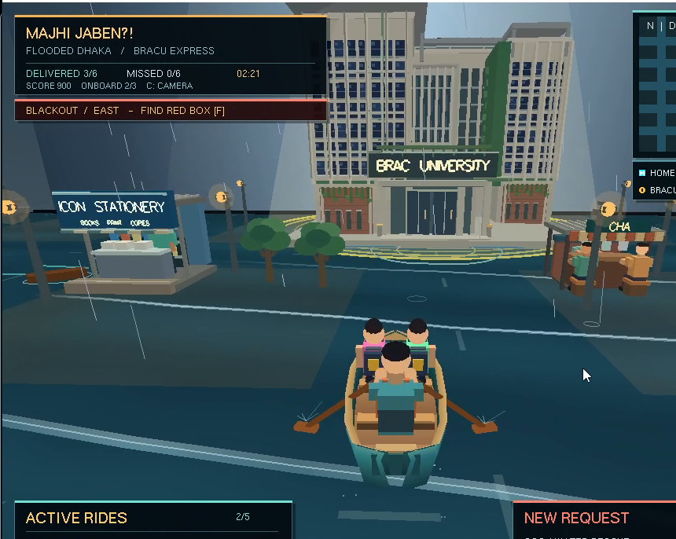
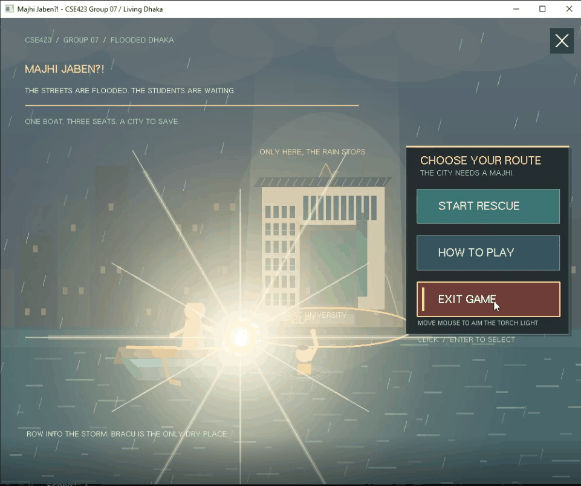
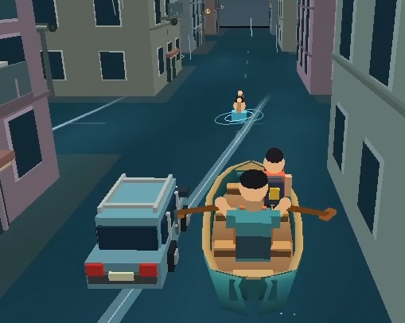
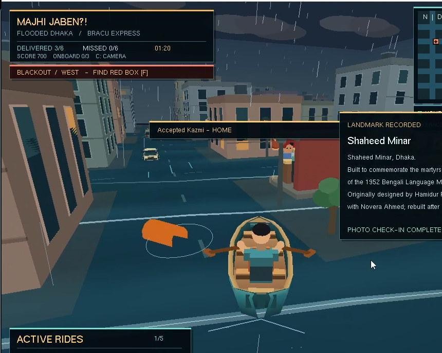
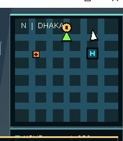

# CSE423 Computer Graphics — From Pixels to Paddles 🚣

**A semester journey from OpenGL basics to _Majhi Jaben?!_ — a 3D boat rescue game set in a flooded Dhaka.**

**Course:** CSE423 · Computer Graphics · BRAC University  
**Section:** 16 · **Project Group:** 07  
**Team:** Adittya Kumar Chowdhury · Nafisa Lubaba · Usaeed Rahman Tibro  
**Technology:** Python · PyOpenGL · OpenGL / GLU / GLUT

> We started with points, lines and transforms in the lab — and ended up building a flooded-city rescue game with missions, landmarks, traffic, a minimap and a very dramatic menu.

<p align="center">
  
  <br />
  <sub><strong>Majhi Jaben?!</strong> — Cinematic Edition gameplay screenshot.</sub>
</p>

---

## 🚣 About the project

**Majhi Jaben?!** is a stylized rescue-and-delivery game inspired by Dhaka’s monsoon flooding and our own real experience of traveling through heavy rain during the semester. In the game, the roads are flooded, students are stranded, and the player becomes a **majhi** (boatman) who must carry passengers to safety and to **BRAC University**.

The tone is intentionally playful. One of our favorite jokes is that **BRAC University is the only sunny place in the entire flooded city**, inspired by the classic **Oggy and the Cockroaches** “sunlight spotlight” meme. Even the **main menu fights back** — if you move toward **Exit Game**, the spotlight literally aims at you.

---

## ✨ Gameplay highlights

### 1) The menu
Hovering over **Exit Game** triggers the giant spotlight towards YOU.

<p align="center">
  
</p>

### 2) A few important gameplay systems

| Passenger pickup / rescue | Landmark photo challenge |
| --- | --- |
|  |  |
| Pick up stranded passengers from flooded streets and bring them to safety. | Photograph important landmarks like **Shaheed Minar** for bonus points. |

### 3) Real-time minimap

<p align="center">
  
  <br />
  <sub>The minimap helps track the player's position and nearby destinations.</sub>
</p>

---

## 📁 Repository structure

```text
CSE423 Repository/
├── Lab 1/
│   ├── Assignment 1/
│   ├── Hello_openGL.py
│   └── Lets_draw_sth.py
├── Lab 2/
│   └── Lab2Assignment22301518.py
├── Lab 3/
├── Project proposal document/
│   ├── Actual submitted report.docx
│   └── Updated report after CSE423 course ended....docx
├── Project submitted/
│   └── MajhiJaben_FinalVersion.py
├── Updated project after CSE423 ended/
│   └── MajhiJaben_CinematicEdition_NoComments.py
├── media/
│   ├── bracu-campus.jpg
│   ├── exit-searchlight.gif
│   ├── landmark-challenge.jpg
│   ├── passenger-pickup.jpg
│   └── minimap-view.jpg
└── README.md
```

This keeps the **graded submission** separate from the **post-course improved version**.

---

## 🎓 What we learned in CSE423 and how it appears in the game

| Course component | What we learned | How it appears in *Majhi Jaben?!* |
| --- | --- | --- |
| **Intro OpenGL templates** | Points, lines, primitive drawing, coordinate systems | Buildings, roads, HUD elements, rain and world objects |
| **Lab 1 / Assignment 1** | Basic animation, interactive drawing, color control | Weather, screen effects and general 2D scene building |
| **Lab 2 / Assignment 2** | Line logic, interaction, collision-style thinking, game flow | Pickup systems, hazards, movement checks and gameplay logic |
| **Lab 3 / Assignment 3** | 3D transforms, perspective, camera control | 3D boat scene, third-person view, first-person view, obstacle layout |
| **Final project** | Combining rendering, animation, input and game logic | Flooded city exploration, rescue missions, photo challenge and minimap |

---

## 🗂️ Project versions

### 1. Original faculty proposal
Located in **`Project proposal document/`**. This contains the original idea submitted to the faculty.

### 2. Actual graded submission
Located in **`Project submitted/MajhiJaben_FinalVersion.py`**. This is the version used for course evaluation.

### 3. Post-course updated version
Located in **`Updated project after CSE423 ended/MajhiJaben_CinematicEdition_NoComments.py`**. This is the more polished version with better visuals, more atmosphere and additional refinements.

> The screenshots and GIFs in this README are from the later improved version.

---

## 🛠️ How to run

Install dependencies:

```powershell
py -m pip install PyOpenGL PyOpenGL_accelerate
```

Run the graded course submission:

```powershell
py "Project submitted/MajhiJaben_FinalVersion.py"
```

Run the improved Cinematic Edition:

```powershell
py "Updated project after CSE423 ended/MajhiJaben_CinematicEdition_NoComments.py"
```

---

## 👥 Credits

**Adittya Kumar Chowdhury · Nafisa Lubaba · Usaeed Rahman Tibro**  
**CSE423: Computer Graphics · BRAC University · Group 07 · Section 16**

The game is inspired by real flooding experiences, but it is still a humorous student project — especially the idea that **BRAC University is the one magically dry and sunny place in the city**.

---

*From pixels to paddles — and from lab templates to a full rescue game.*
